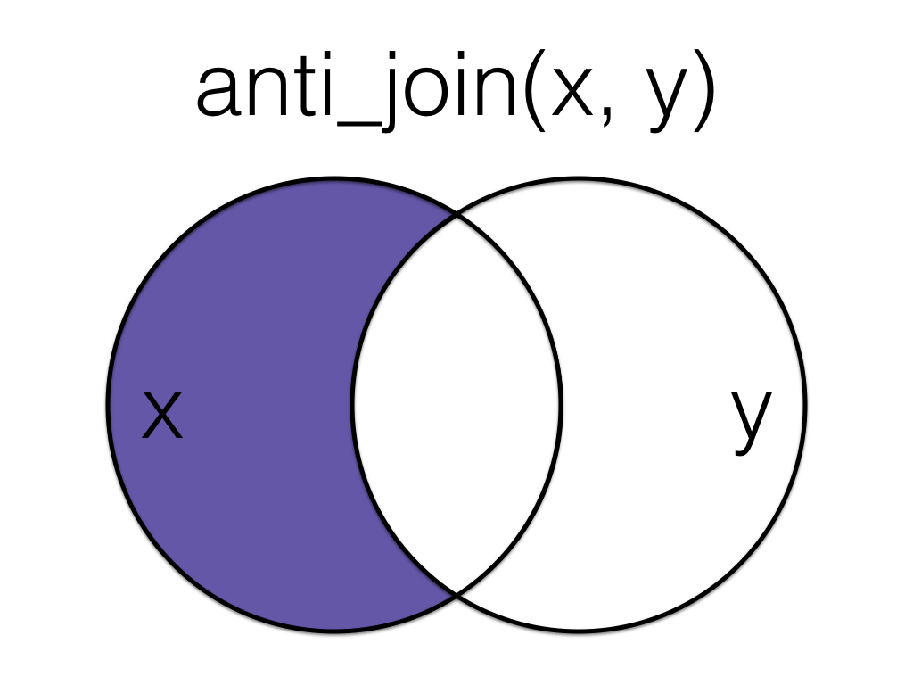

# 

{width="40%" fig-align="center"}

<https://bit.ly/3Wqe23R>

<https://michael-weylandt.com/BaruchCTLWeek>


# Review 

## Single-Table Verbs

`dplyr` single-table verbs

::: {.incremental}

- `select`, `filter`: Selecting rows and columns
- `rename`, `mutate`: Changing rows and columns
- `summarize`, `group_by`: Combining multiple rows
- `arrange`, `slice_min/max`: Re-ordering

:::

. . . 

[Lab #05 Review Activity](https://michael-weylandt.com/STA9750/labs/lab05.qmd#review)

# Multi-Table Verbs

## Multi-Table Analysis

*Multiple Tables*:

- More insights than from a single table
- Maintain 'tidy' structure throughout

Will create new (compound) rows: 

- Dangers: *drops* and *(over) duplication*

## Primary Keys

_Keys_ are unique identifiers for individual records

- Primary (one column) or compound (multiple columns together) 


. . . 


The history of corporate IT is largely one of (failed) primary keys

- Finance: Tickers, Tickers + Exchange, Tickers + Share Class, CUSIP, ISIN,
  SEDOL, ... 
  
  
. . . 

Meaningful true keys are vanishingly rare - cherish them when you find them

Often 'unique enough' for an analysis

`dplyr::group_by() + dplyr::count()` is helpful here


## Keys in Your Life

What _primary keys_ and _compound keys_ are used to identify you? 

. . . 

::: {.incremental}

- CUNY EmplID
- Name
- Name + Birthday
- Name + Birthday + ???
- National ID Number (SSN?)

:::

## Joins

Joins combine tables _by identity_ - not simple 'stacking' 

Specify a _join key_ - ideally this is an actual key, but doesn't have to be

In `dplyr`, we use the `join_by` function: 

```{r}
#| eval: false
#| echo: true
dplyr::join_by(table_1_name == table_2_name)
```

Here `table_1_name` and `table_2_name` are column names from two tables

. . . 

Join rows where these values are equal (advanced joins possible)

## Inner and Outer Joins

When tables are perfectly matched, not an issue: 

```{r}
#| echo: false
library(dplyr)
cunys <- tribble(~college, ~campus_borough, 
             "CCNY", "Manhattan",
             "Baruch", "Manhattan", 
             "CSI", "Staten Island",
             "York", "Queens")

routes <- tribble(~borough_name, ~bus_code,
                  "Manhattan", "M",
                  "Staten Island", "S", 
                  "Queens", "Q")
```

```{r}
cunys
```

```{r}
routes
```

## Inner and Outer Joins

When tables are perfectly matched, not an issue: 

```{r}
inner_join(cunys, routes, join_by(campus_borough == borough_name))
```

Default to `inner` but irrelevant

Note automatic repetition of `"M"` row

## Inner and Outer Joins

How to handle 'unaligned' values?

. . . 

Add MEC

```{r}
#| echo: false
cunys <- tribble(~college, ~campus_borough, 
                 "CCNY", "Manhattan",
                 "Baruch", "Manhattan", 
                 "CSI", "Staten Island",
                 "York", "Queens", 
                 "Medgar Evers", "Brooklyn")
```

```{r}
#| echo: true
cunys
```

## Inner and Outer Joins

```{r}
#| echo: true
inner_join(cunys, routes, join_by(campus_borough == borough_name))
```

. . . 

[**MEC vanished!**]{color="red"}

## Inner and Outer Joins

```{r}
#| echo: true
left_join(cunys, routes, join_by(campus_borough == borough_name))
```

MEC stays, but no bus code - `NA` value

. . . 

::: {.smaller}

- `inner_join` - Keep only matches
- `left_join` - Keep all rows in left (first) table even w/o matches
- `right_join` - Keep all rows in right (second) table even w/o matches
- `full_join` - Keep all rows from both tables, even w/o matches

:::

`left_` and `right_` are types of 'outer' joins

## Selecting Joins

Suppose we seek to join two tables, `x` and `y`: 

{width="30%"}

. . . 

- Some shared rows (`1` and `2`) but 
- Some non-shared rows (`3` in table `x` and `4` in table `y`). 

Different joins will differ in how they treat those non-shared rows. 

## Multiply and Conquer

_Conceptually_ think of starting with all possible pairs. 

:::: {.columns}

::: {.column width="40%"}

- For us, $9 = 3 \times 3$ total possible pairings: 

:::

::: {.column width="40%"}


{width="70%"}

:::

::::

::: {.smaller}

*NB:* You do not generally want to _actually_ make all these pairs when dealing
with large data - this is just a mental tool.

:::

## Multiply and Conquer

Join specification (`join_by()`) controls which of these pairs survive. 

- basic (equality) join: `join_by(x==y)`

. . . 


:::: {.columns}

::: {.column width="40%"}

All joins will capture the proper matches (`1` and `2`): 

- the only difference is in the treatment of unmatched pairs. 

:::

::: {.column width="40%"}


{width="70%"}

:::

::::

## Inner Join

The most restrictive join -- the `inner_join` -- only captures _true matches_: 

{width="50%"}

No match for the orange or yellow rows $\implies$ `inner_join` discards them. 

## Left Join

To keep the unmatched orange `3`, use a `left_join`: 

{width="40%"}

. . . 

- Keep everything in the left (`x`) table
- Fill missing values with `NA` (`y` for orange row)

## Right Join

The `right_join` is the exact opposite: 

{width="40%"}

. . . 

- Keep everything in the right (`x`) table
- Fill missing values with `NA` (`x` for yellow row)
- `left_join(x, y) == right_join(y, x)`

## Full Join

`full_join` keeps everything: 

{width="40%"}
. . . 

- **NB**: doesn't force a match for orange `3` or yellow `4`. 
- Both unmatched, both `NA`

## Venn Diagrams as Joins

If you think this all sounds like Venn diagrams and set theory, you aren't wrong:

{fig-align="center"}

## So Which One?

Q: So which one should I **actually** use?

. . . 

A: No easy answer. Depends on the treatment of _missing values_. 

. . . 

- `inner_join()` drops missing values, simplifying later steps

- outer joins (`left`, `right`, `full`) force you to interact with missing values

. . . 

Think about _what_ you will do with missing values. 

- Report number of missing values: `left_join`
- Discard and carry on: `inner_join`

## Missingness

Three models of missingness: 

::: {.incremental}

- Missing Completely at Random (MCAR) - Random & _Unrelated_ to QoIs
  - Data Termites
- Missing at Random (MAR) - Random, but Correlated to QoIs
- Missing Not at Random (MNAR) - Adversarial
  - Data Demons

:::

. . . 

MCAR missingness is a strong and rare condition, but it's really the 
only situation where it's **totally safe** to just drop missing values. 

. . . 

Why is it missing? 

::: {.incremental .small} 

- `flights` data: *missing* delays indicate cancelled flights. 
   Should you throw them out when looking at on time performance? 
-  weather data: data missing when tornado blows monitor off the roof. 
   Impact on average wind speed?

:::

# Your Turn

## Movie Development

Long Example / 'Mini-Project': 

- Roleplay as Holywood _Development Executive_
- Come up with a movie pitch based on past successes

## Data 

From IMDB, 5 Tables: 

- `NAME_BASICS`: Basic Info (Name, Year, Best Known For)
- `TITLE_BASICS`: Basic Info (Title, Year, Genre, *etc.*)
- `TITLE_RATINGS`: Average Rating + Number of Votes
- `TITLE_CREW`: Writers and Directors
- `TITLE_PRINCIPALS`: Actors, Composers, DPs, Editors, *etc*

## Tables

```{r}
#| echo: false
#| message: false
library(tidyverse)
library(gt)
tiny_table <- function(x){
    xx <- as_label(enquo(x))
    x |> slice_sample(n=10) |> gt(id=paste0("tbl_", tolower(xx))) |> tab_header(xx)
}
```

```{r}
#| echo: false
#| cache: true
NAME_BASICS <- read_csv("docs/data/processed/name_basics.csv.gz")
tiny_table(NAME_BASICS)
```

## Tables

```{r}
#| echo: false
#| cache: true
TITLE_BASICS <- read_csv("docs/data/processed/title_basics.csv.gz")
tiny_table(TITLE_BASICS)
```


## Tables

```{r}
#| echo: false
#| cache: true
TITLE_RATINGS <- read_csv("docs/data/processed/title_ratings.csv.gz")
tiny_table(TITLE_RATINGS)
```

## Tables

```{r}
#| echo: false
#| cache: true
TITLE_CREW <- read_csv("docs/data/processed/title_crew.csv.gz")
tiny_table(TITLE_CREW)
```

## Tables

```{r}
#| echo: false
#| cache: true
TITLE_PRINCIPALS <- read_csv("docs/data/processed/title_principals.csv.gz")
tiny_table(TITLE_PRINCIPALS)
```

## Warm-Up

Warm Up: What movies is Harrison Ford known for?

. . . 

- Table 1: `NAME_BASICS` - Find Harrison Ford and pull `knownForTitles`
- Table 2: `TITLE_BASICS` - Map `tconst` values to movie names
- Join: `knownForTitles` to `tconst`

. . . 

_Inner_ join because we will ultimately ignore 'unknown' movies

## Warm-Up


Pull out "Harrison Ford":

```{r}
#| echo: true
#| eval: false
NAME_BASICS  |>
    filter(primaryName == "Harrison Ford")
```

```{r}
#| echo: false
NAME_BASICS  |>
    filter(primaryName == "Harrison Ford") |>
    gt() |>
    cols_label(primaryName="Name",
               birthYear="Birth Year",
               deathYear="Death Year",
               knownForTitles="Known For") |>
    cols_hide(primaryProfession) |>
    tab_header("Best of Harrison Ford")
```


## Warm-Up

Not this guy: 

{width="35%" fig-align="center"}

## Warm-Up

```{r}
#| echo: true
#| eval: false
NAME_BASICS  |>
    filter(primaryName == "Harrison Ford", 
           birthYear>1900)
```

```{r}
#| echo: false
#| eval: true
NAME_BASICS  |>
    filter(primaryName == "Harrison Ford", 
           birthYear>1900) |>
    gt() |>
    cols_label(primaryName="Name",
               birthYear="Birth Year",
               deathYear="Death Year",
               knownForTitles="Known For") |>
    cols_hide(primaryProfession) |>
    tab_header("Best of Harrison Ford")
```

## Warm-Up

:::: {.columns}

::: {.column width="40%"}

```{r}
#| echo: false
NAME_BASICS |> 
    select(nconst, primaryName, knownForTitles) |>
    slice_sample(n=5) |>
    gt() |>
    tab_header("NAME_BASICS")
```

:::


::: {.column width="40%"}

```{r}
#| echo: false
TITLE_BASICS |> 
    select(tconst, primaryTitle) |>
    slice_sample(n=5) |>
    gt() |>
    tab_header("TITLE_BASICS")
```

:::

::::

. . . 

What _type_ of join? What _column(s)_ to join?

## Warm-Up

`inner_join` on `knownForTitles`/`tconst` to find matching rows: 

```{r}
#| echo: true
#| eval: false
NAME_BASICS  |>
    filter(primaryName == "Harrison Ford", 
           birthYear>1900) |>
    inner_join(TITLE_BASICS,
               join_by(knownForTitles == tconst))
```


```{r}
#| echo: false
NAME_BASICS  |>
    filter(primaryName == "Harrison Ford", 
           birthYear>1900) |>
    separate_longer_delim(knownForTitles, ",") |>
    inner_join(TITLE_BASICS,
               join_by(knownForTitles == tconst)) |>
    select(nconst, primaryName, knownForTitles, primaryTitle, startYear, genres) |>
    gt() |>
    cols_label(primaryName="Name",
               knownForTitles="tconst",
               primaryTitle="Title",
               startYear="Release Year",
               genres="Genre",) |>
    tab_header("Best of Harrison Ford")
```

## Warm-Up

{fig-align="center" width="60%"}

## Analysis

Analytic Pipeline: 

1) What does it mean for a movie to be successful? 
2) What genre has a high success rate? 
3) What are the most successful movies in that genre?
4) What directors are successful in that genre?
5) What actors have never worked in that genre?
6) Pitch Time!

# Defining Success

Design a 'success' measure for IMDb entries, reflecting both quality and
broad popular awareness. 


## 1. Defining Success

How can we quantify _success_ (without box office)?

. . . 

- _Lots_ of votes (quantity)
- _High_ ratings (quality)

## 1. Defining Success


:::: {.columns}

::: {.column width="40%"}

Ratings Table:

```{r}
#| echo: false
TITLE_RATINGS |> 
    slice_sample(n=5) |>
    gt() |>
    tab_header("TITLE_RATINGS")
```

:::

::: {.column width="40%"}

Movies Table:

```{r}
#| echo: false
TITLE_BASICS |> 
    select(tconst, primaryTitle) |>
    slice_sample(n=5) |>
    gt() |>
    tab_header("TITLE_BASICS")
```

:::

::::

. . . 

What _type_ of join? What _column(s)_ to join?


## 1. Defining Success

`inner_join` on `tconst`/`tconst` to find matching rows: 

```{r}
#| echo: true
#| eval: false
TITLE_BASICS  |>
    inner_join(TITLE_RATINGS,
               join_by(tconst == tconst))
```

```{r}
#| echo: false
#| eval: true
TITLE_BASICS  |>
    inner_join(TITLE_RATINGS,
               join_by(tconst == tconst)) |> 
    select(tconst, primaryTitle, averageRating, numVotes) |>
    slice_max(numVotes, n=10) |>
    gt()
```

## 1. Defining Success

`inner_join` on `tconst`/`tconst` to find matching rows: 

```{r}
#| echo: true
#| eval: false
TITLE_BASICS  |>
    inner_join(TITLE_RATINGS,
               join_by(tconst == tconst))
```

```{r}
#| echo: false
#| eval: true
TITLE_BASICS  |>
    inner_join(TITLE_RATINGS,
               join_by(tconst == tconst)) |> 
    ggplot(aes(x=numVotes, y=averageRating)) + 
    geom_point(alpha=0.2) + 
    geom_smooth() + 
    scale_x_log10() + 
    theme_bw() + 
    xlab("Number of IMDb Votes") + 
    ylab("Average IMDb Rating")
```


## 1. Defining Success

Possible metric: 

$$S = \frac{\text{Number of Votes}}{1 + e^{-\text{Average Rating}}}$$

. . . 

How can we validate?

## 1. Defining Success

Top Movies: 

```{r}
#| echo: false
TITLE_SUCCESS <- TITLE_BASICS |> 
    select(tconst, primaryTitle, startYear) |> 
    inner_join(TITLE_RATINGS, join_by(tconst == tconst)) |> 
    mutate(success = numVotes / (1 + exp(-averageRating)))

TITLE_SUCCESS |> 
    slice_max(success, n=10) |> 
    gt() |>
    tab_header("Top Films (per Logistic Success Metric)") |>
    cols_hide(tconst) |>
    cols_label(primaryTitle="Title", 
               startYear="Release Year",
               success="Success Metric",
               numVotes="Number of IMDb Ratings",
               averageRating="Average Rating")
```

## 1. Defining Success

Bottom Films: 

```{r}
#| echo: false
TITLE_SUCCESS |> 
    slice_min(success, n=5) |> 
    gt() |>
    tab_header("Bottom Films (per Logistic Success Metric)") |>
    cols_hide(tconst) |>
    cols_label(primaryTitle="Title", 
               startYear="Release Year",
               success="Success Metric",
               numVotes="Number of IMDb Ratings",
               averageRating="Average Rating")
```

. . . 

I don't know these - not box office success, but maybe not terrible

## 1. Defining Success

Lowest rated film with $>100,000$ of ratings, *The Room*:

::: {.center}



:::

# Genre

Identify a good genre for your film.

*(Speeding up a bit now for time)*

## 2. Picking a Genre


:::: {.columns}

::: {.column width="40%"}

Ratings Table:

```{r}
#| echo: false
TITLE_RATINGS |> 
    slice_sample(n=5) |>
    gt() |>
    tab_header("TITLE_RATINGS")
```

:::

::: {.column width="40%"}

Movies Table:

```{r}
#| echo: false
TITLE_BASICS |> 
    select(tconst, primaryTitle) |>
    slice_sample(n=5) |>
    gt() |>
    tab_header("TITLE_BASICS")
```

:::

::::

. . . 

What _type_ of join? What _column(s)_ to join?

## 2. Picking a Genre

Genre success: 

```{r}
#| echo: false
TITLE_BASICS |> 
    separate_longer_delim(genres, ",") |>
    rename(genre=genres)|> 
  select(tconst, genre) |>
  inner_join(TITLE_SUCCESS, 
             join_by(tconst==tconst)) |>
  filter(startYear > 2000) |> 
  group_by(genre) |>
  summarize(n_productions = n(), 
            p_success = mean(success > 100000), 
            n_success = sum(success>100000)) |> 
  arrange(desc(p_success)) |>
  gt() |>
  cols_label(genre="Genre",
             p_success="Fraction of Successes",
             n_success="Number of Successes", 
             n_productions="Total Number of Films") |>
    fmt_percent(p_success, decimals=2)
```


# Remake

Find a classic movie to remake with your key talent. The original should have
a large number of IMDb ratings, a high average rating, and not have been remade
in the past 25 years.


## 3. Remake


:::: {.columns}

::: {.column width="40%"}

Ratings Table:

```{r}
#| echo: false
TITLE_RATINGS |> 
    slice_sample(n=5) |>
    gt() |>
    tab_header("TITLE_RATINGS")
```

:::

::: {.column width="40%"}

Movies Table:

```{r}
#| echo: false
TITLE_BASICS |> 
    select(tconst, primaryTitle) |>
    slice_sample(n=5) |>
    gt() |>
    tab_header("TITLE_BASICS")
```

:::

::::

. . . 

What _type_ of join? What _column(s)_ to join?

## 3. Remake

Top 10 Sci-Fi Films of All Time: 

```{r}
#| echo: false
TITLE_BASICS |> 
    select(tconst, genres) |>
    inner_join(TITLE_SUCCESS, 
               join_by(tconst==tconst)) |>
    filter(str_detect(genres, "Sci-Fi")) |> 
    group_by(primaryTitle) |> 
    summarize(max_success = max(success), 
              latest_made = max(startYear), 
              versions=n()) |> 
    arrange(desc(max_success)) |>
    slice_max(max_success, n=10) |>
    gt() |>
    cols_label(primaryTitle="Title", 
               latest_made="Latest Release",
               versions="Number of Remakes",
               max_success="Peak Score")
```

## 3. Remake

{fig-align="center" width="90%"}

# Director


Identify a director for your film. This should be someone with a 
track-record of successful films in your chosen genre. Ideally, they will not
have worked in your genre recently - perhaps having a flop in a different genre 
- and you will be able to market your film as a 'triumphant return to form'.

## 4. Director


:::: {.columns}

::: {.column width="20%"}

Ratings Table:

```{r}
#| echo: false
TITLE_RATINGS |> 
    slice_sample(n=5) |>
    gt() |>
    tab_header("TITLE_RATINGS")
```

:::

::: {.column width="20%"}

Movies Table:

```{r}
#| echo: false
TITLE_BASICS |> 
    select(tconst, primaryTitle) |>
    slice_sample(n=5) |>
    gt() |>
    tab_header("TITLE_BASICS")
```

:::

::: {.column width="20%"}

People Table:

```{r}
#| echo: false
NAME_BASICS |> 
    select(nconst, primaryName) |>
    slice_sample(n=5) |>
    gt() |>
    tab_header("NAME_BASICS")
```

:::

::: {.column width="40%"}

Credits Table:

```{r}
#| echo: false
TITLE_CREW |> 
    slice_sample(n=5) |>
    gt() |>
    tab_header("TITLE_CREW")
```

:::

::::

## 4. Director

We need a _four way_ join: 

- RATINGS to BASICS: to get scores and genre
- BASICS to CREW: to get director ID
- CREW to NAMES: to convert director ID (`nconst`) to actual names

. . . 

```{r}
#| echo: true
#| eval: false
TITLE_BASICS |> 
    inner_join(TITLE_SUCCESS, 
               join_by(tconst==tconst)) |>
    inner_join(TITLE_CREW, 
               join_by(tconst==tconst)) |>
    inner_join(NAME_BASICS, 
               join_by(directors==nconst))
```

Read `|>` as _and then_

## 4. Director

```{r}
#| echo: false
TITLE_BASICS |> 
    select(tconst, genres) |>
    inner_join(TITLE_SUCCESS, 
               join_by(tconst==tconst)) |>
    inner_join(TITLE_CREW, 
               join_by(tconst==tconst)) |>
    inner_join(NAME_BASICS, 
               join_by(directors==nconst)) |>
    mutate(scifi = str_detect(genres,"Sci-Fi")) |>
    group_by(primaryName, scifi) |>
    summarize(n_films = n(), 
              latest = max(startYear), 
              average_success = mean(success)) |>
    ungroup() |>
    pivot_wider(id_cols=primaryName, 
                names_from=scifi, 
                values_from=c(n_films, latest, average_success), 
                names_glue="{.value}_scifi_{scifi}", 
                values_fill=0) |>
    filter(average_success_scifi_TRUE > 700000, 
           latest_scifi_FALSE > 2015,
           latest_scifi_TRUE < 2015) |>
    arrange(desc(average_success_scifi_TRUE / average_success_scifi_FALSE)) |>
    gt(id="tbl_top_directors") |>
    cols_label(primaryName="Director Name") |> 
    tab_header("Top Sci-Fi Directors") |>
    tab_spanner(
        label="Sci-Fi",
        columns=ends_with("_TRUE")) |>
    tab_spanner(
        label="NonSci-Fi",
        columns=ends_with("_FALSE")) |>
    cols_label(
        contains("n_films") ~ "Number of Films",
        contains("latest") ~ "Latest Film", 
        contains("average") ~ "Average Success Score"
    )
```

## 4. Director

{width="40%" fig-align="center"}

## 4. Director

:::: {.columns}

::: {.column width="40%"}

2004: **Eternal Sunshine**

{fig-align="center" width="80%"}

:::

::: {.column width="40%"}

2011 **Green Hornet**

{fig-align="center" width="80%"}

:::

::::

# Actors

Identify two stars with multiple credits to their name to take the leading roles
in your film. These should be actors with a strong track record of success 
who have not worked in your chosen genre before.

## 5. Actors

New constraint: **have not worked in Sci-Fi**

:::: {.columns}

::: {.column width="20%"}

Ratings Table:

```{r}
#| echo: false
TITLE_RATINGS |> 
    slice_sample(n=5) |>
    gt() |>
    tab_header("TITLE_RATINGS")
```

:::

::: {.column width="20%"}

Non-SciFi Movies Table:

```{r}
#| echo: false
TITLE_BASICS |> 
    filter(str_detect(genres, "Sci-Fi")) |>
    select(tconst, primaryTitle) |>
    slice_sample(n=5) |>
    gt() |>
    tab_header("TITLE_BASICS_SCIFI")
```

:::

::: {.column width="20%"}

People Table:

```{r}
#| echo: false
NAME_BASICS |> 
    select(nconst, primaryName) |>
    slice_sample(n=5) |>
    gt() |>
    tab_header("NAME_BASICS")
```

:::

::: {.column width="40%"}

Credits Table:

```{r}
#| echo: false
TITLE_CREW |> 
    slice_sample(n=5) |>
    gt() |>
    tab_header("TITLE_CREW")
```

:::

::::

## 5. Actors

{fig-align="center" width="30%"}


`anti_join` people and Sci-Fi movies: 

::: {.incremental}

- `anti_join` finds rows _without_ a match
- actors _without_ a sci-fi credit

:::

## 5. Actors

{width="50%" fig-align="center"}

## 5. Actors

```{r}
#| echo: false
NO_SCIFI_HISTORY_ACTORS <- TITLE_BASICS |> 
    select(tconst, genres) |>
    inner_join(TITLE_SUCCESS, 
               join_by(tconst==tconst)) |>
    inner_join(TITLE_PRINCIPALS, 
               join_by(tconst==tconst)) |>
    inner_join(NAME_BASICS, 
               join_by(nconst==nconst)) |>
    mutate(scifi = str_detect(genres,"Sci-Fi")) |>
    group_by(primaryName) |>
    filter_out(any(scifi)) |> 
    summarize(n_films = n(), 
              first = min(startYear),
              latest = max(startYear), 
              average_success = mean(success))

NO_SCIFI_HISTORY_ACTORS |>
    filter(n_films > 20) |>
    slice_max(average_success, n=10) |>
    gt(id="tbl_top_actors_doc") |>
    cols_label(
        primaryName="Actor for Doc Brown",
        n_films="Number of Major Acting Credits",
        latest="Latest Credit",
        average_success="Average Success"
    ) |>
    cols_hide(first)
```

## 5. Actors

{width="40%" fig-align="center"}

## 5. Actors

```{r}
#| echo: false
NO_SCIFI_HISTORY_ACTORS |> 
    slice_max(first) |>
    gt(id="tbl_top_actors_marty") |>
    cols_label(primaryName="Actor for Marty McFly", 
               n_films="Number of Major Acting Credits",
               first="Film Debut", 
               average_success="Average Success") |>
    cols_hide(latest)
```

. . .

{width="65%" fig-align="center"}


# Pitch

##

{width="50%" fig-align="center"}

